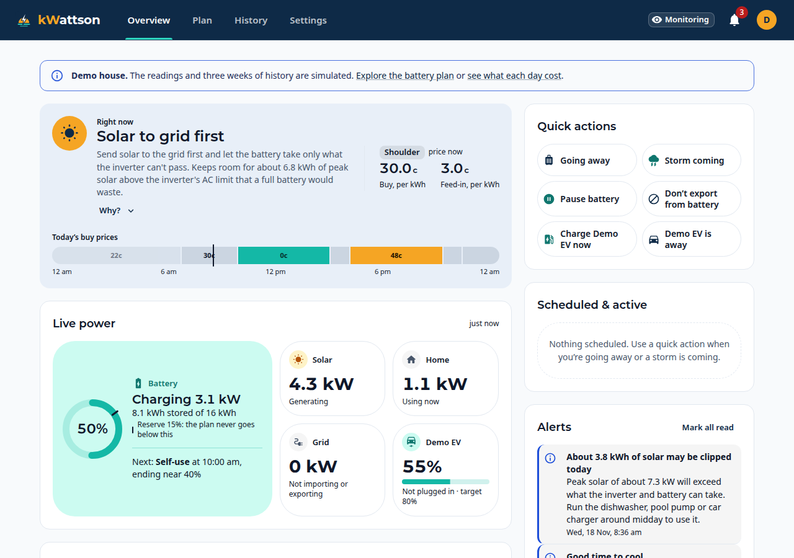
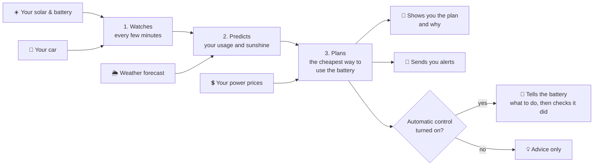
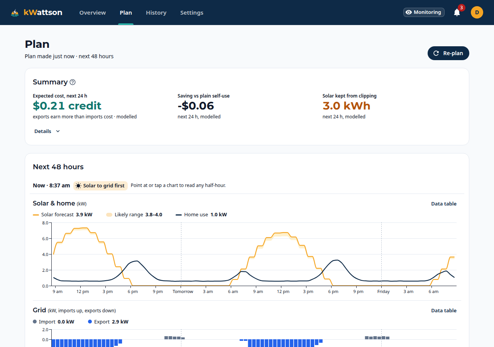
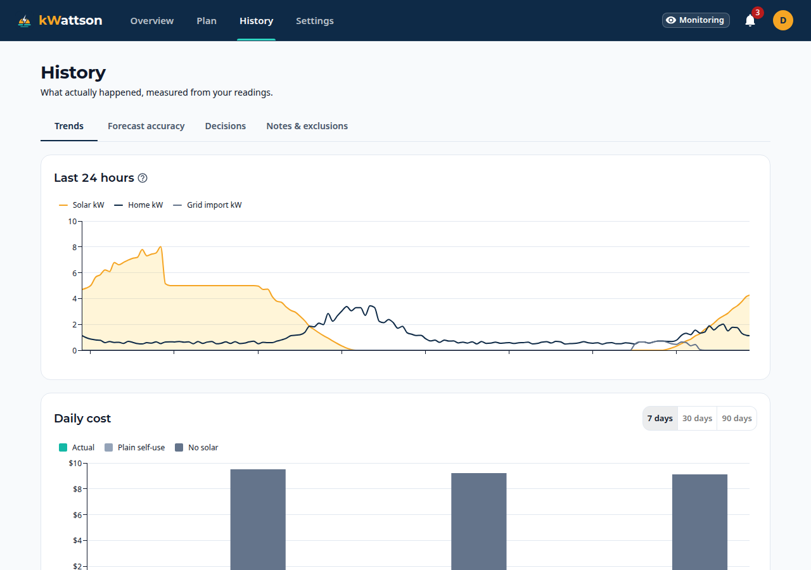
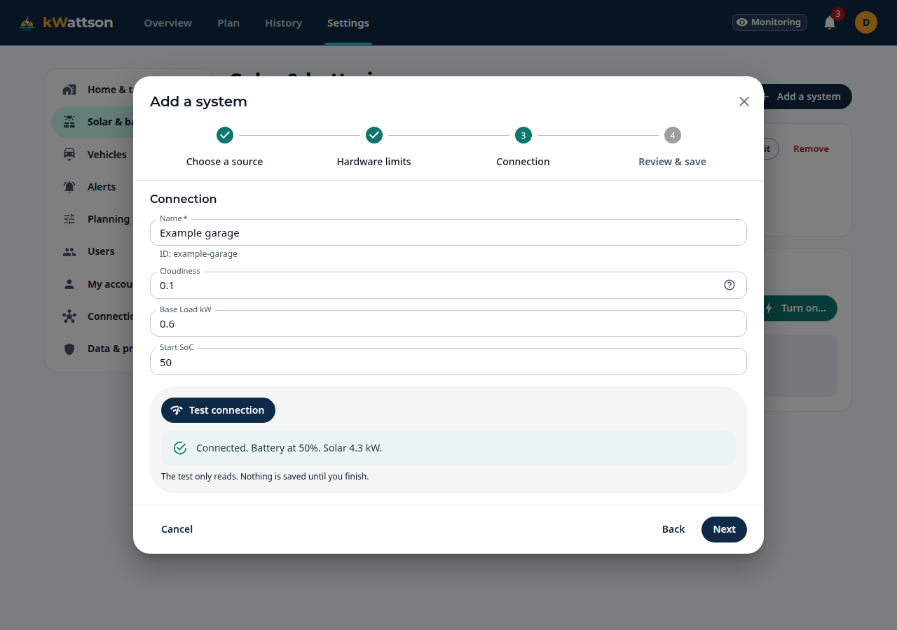
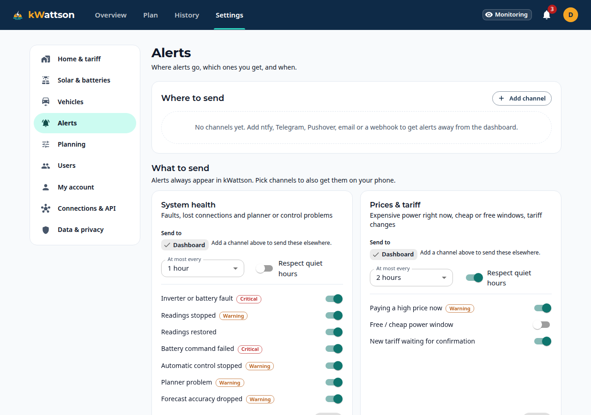
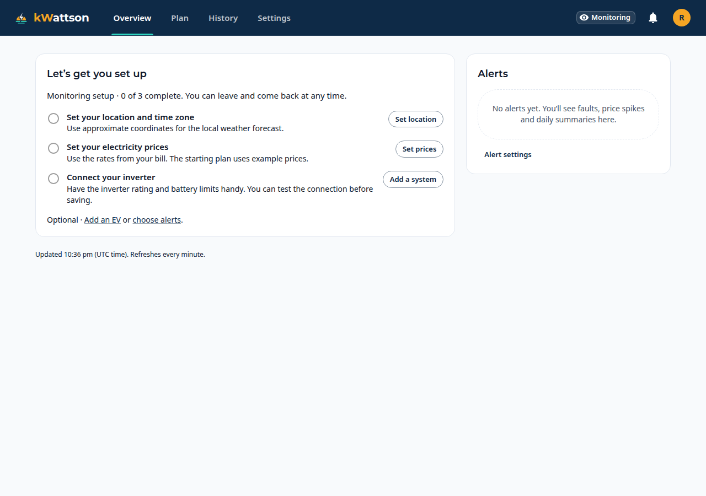
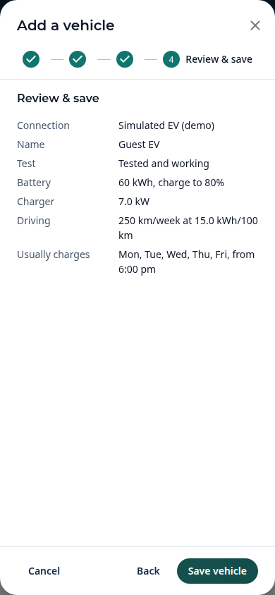
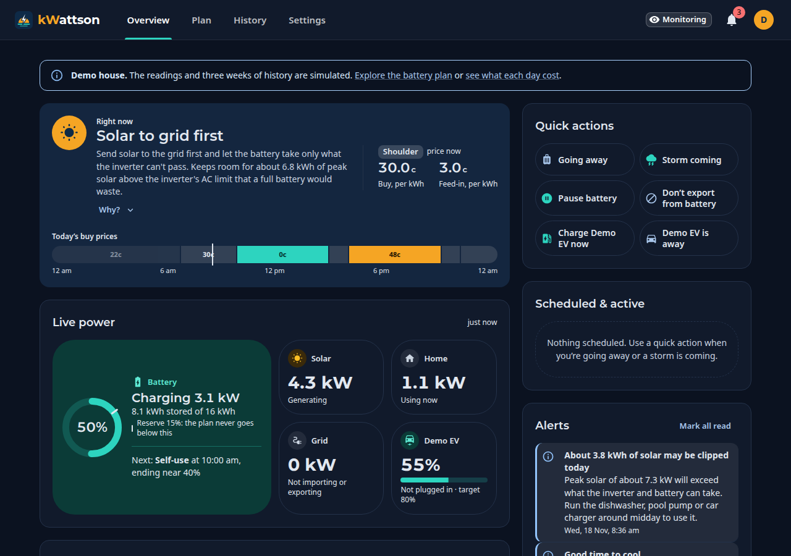
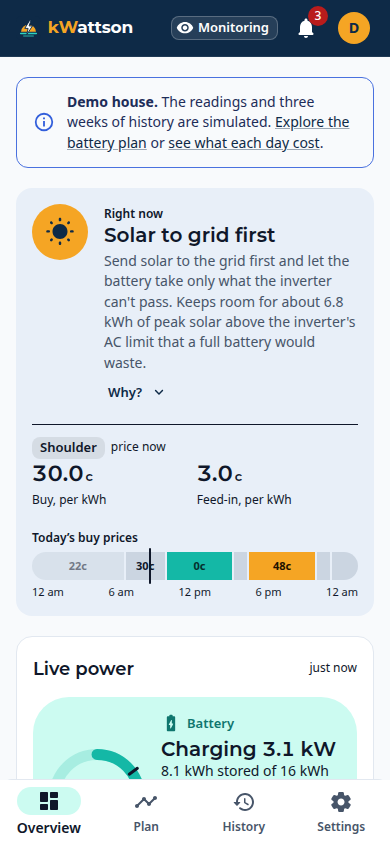

<p align="center">
  
</p>

kWattson helps you decide when to charge your home battery, use stored solar or export it.
It combines your meter readings, the weather forecast and the prices on your electricity bill
into a two-day plan. It starts in monitoring mode. Each planned action includes a reason.

<p align="center">
  
</p>

## Try the demo

From the project directory with Docker installed, run:

```sh
docker build -t kwattson .
docker run --rm --name kwattson-demo -p 127.0.0.1:8080:8080 \
  -e DEMO_MODE=true -e DEMO_PASSWORD=sample-house-demo-only \
  -e APP_URL=http://localhost:8080 -e DEV_HTTP=true kwattson
```

Open <http://localhost:8080> and sign in as **demo** with **sample-house-demo-only**.
The container starts with a simulated battery, EV and three weeks of sample readings.
On **Overview**, check where the power is going. Open **Plan** to see why the battery will charge or
discharge, then **History** to compare daily costs. Stop the demo with Ctrl+C in its terminal.
With this command each new container starts with a fresh sample house.

## Set up your own home

1. Follow the Docker deployment guide to create a separate data volume and HTTPS address. [Installation guide](deploy/UNRAID.md)
2. Run `docker exec kwattson kwattson setup-token`. Open your installation, paste the token and create your admin account.
3. On **Overview**, choose **Set location** for weather and **Set prices** for your electricity plan.
   Enter flat rates in cents from your bill, or import a tariff file. Activate the plan from the date your retailer confirmed.
4. Choose **Add a system**. Select how to read your inverter, enter its ratings, test the connection and review it before saving.
   You can add an EV under **Settings → Vehicles** and enable two-step sign-in under **My account**.

Keep the first installation in monitoring mode while you compare its readings with your inverter.
FoxESS scheduler writes and the unofficial MG integration still need verification on physical devices.
Read the commissioning guide before enabling battery commands. [Commissioning](docs/COMMISSIONING.md)

## What it does

- **Plans your battery around your power prices.** It can fill the battery when power is cheap
  or free, and use or sell that power when it's expensive.
- **Plans for surplus solar.** Some inverters can only pass so much power to the house. On a
  sunny day the extra can only go into the battery, so if the battery is already full it's lost.
  kWattson leaves room in the battery for it.
- **Tells you useful things.** For example: the best time to charge the car, a good time to run
  the air conditioner, that you're paying a high price right now, or that something has stopped working.
- **Shows you how you're going.** It shows what today cost, what it would have cost without the
  battery or without solar, and how each week went.

## How it works

1. **It watches.** Every few minutes it reads your solar, battery and power usage from your inverter.
2. **It predicts.** It learns your household's habits (weekdays, weekends, hot days) and checks
   the weather forecast to guess how much power you'll use and how much sun you'll get over the next two days.
3. **It plans.** It works out the cheapest way to use your battery over those two days, based on
   your actual electricity prices.
4. **It explains and acts.** It shows you the plan and the reason for each step. At first it only
   gives advice. If you turn on automatic control, it sends the plan to your battery, checking all
   the time that everything is behaving, and goes back to normal if anything looks wrong.



The history records readings and planning decisions so you can compare forecasts with what actually happened.

## Useful features

- Works on your phone and computer, with a dark mode.
- One-tap buttons for "going away", "storm coming" (keep the battery full) and "charge the car now".
- Alerts by phone app, email or chat (ntfy, Telegram, Pushover, Discord, Home Assistant or email),
  and you choose which ones you get.
- Step-by-step setup for your solar system, battery and car.
- Several people in the house can have their own login, with different levels of access.
- Works with Home Assistant, including an optional automation that pre-cools or pre-heats the
  house when power is cheap.
- Your history and settings are stored in your own home. kWattson only talks to the services you
  set up, such as your inverter's online account, the weather forecast and your chosen alert apps.

<details>
<summary><b>More screenshots</b></summary>

| | |
|---|---|
|  |  |
|  |  |
|  |  |
|  |  |

Screenshots show the simulated demo house and a new installation with sample settings.
</details>

## What it works with

| | |
|---|---|
| **Inverters and batteries** | FoxESS (directly), or anything Home Assistant can already see, or any device that can send readings over the network |
| **Cars** | MG (read-only), anything in Home Assistant, or just type in the battery level yourself |
| **Power prices** | Flat rates from a bill, time-of-use tariff files, or Australian Energy Made Easy plan-detail JSON |

### Add another device brand

If Home Assistant already reads your equipment, map its sensors in the device wizard. A device or
automation can also push readings with an ingest token. For a new direct integration, start with
the installable example meter. The plugin guide covers packaging, installing a wheel in Python or
Docker, and testing discovery in the dashboard. [Example plugin](examples/meter-plugin/) · [Plugin guide](docs/PLUGINS.md)

## Is it safe?

- It starts in **watch-only mode** and changes nothing until you deliberately turn on automatic control.
- Battery commands are short and checked. If readings stop, something looks wrong, or the battery
  doesn't respond as expected, it hands control back to your inverter's normal mode and lets you know.
- The website has a password, optional two-step login, and strict security settings, so it can be
  used safely from outside your home through your own secure (HTTPS) web address.

Please read [docs/COMMISSIONING.md](docs/COMMISSIONING.md) before turning on automatic control.
This is free software provided as is: you stay responsible for your own system.

## For developers and AI assistants

- [AGENTS.md](AGENTS.md) explains how the code is organised and the rules for changing it.
  It's written for people and for AI coding assistants. The `.claude/skills/` folder has
  ready-made instructions for common jobs, such as adding support for a new inverter or checking
  the dashboard.
- [docs/](docs/) explains how the predictions and planning work, what data is stored, and how to write a plugin.
- To build the dashboard yourself: `cd frontend && npm ci --ignore-scripts && npm run build`.

## Licence

MIT. Free to use, change and share. Weather data comes from [Open-Meteo](https://open-meteo.com/).
kWattson isn't connected with FoxESS, MG, Home Assistant or any electricity retailer.
